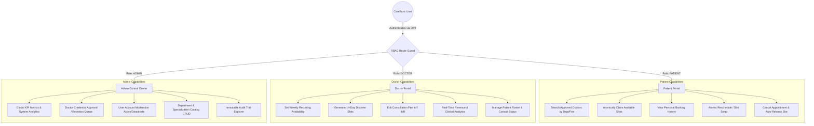
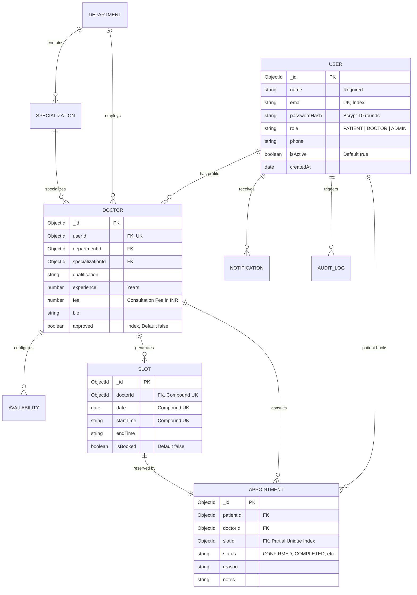
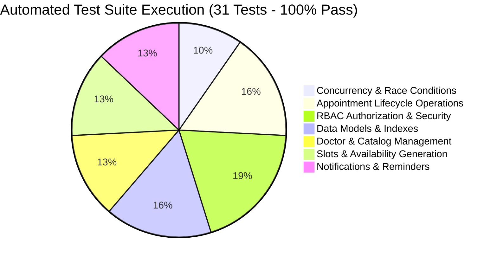

# PRODUCT REQUIREMENT DOCUMENT (PRD)
## SehatSetu (formerly CareSync) — Full-Stack Healthcare Appointment & Clinical Lifecycle Management System with High-Concurrency Atomic Booking Engine

---

### Document Information
- **Project Title:** SehatSetu (Bridge to Health) — Real-Time Healthcare Appointment System (HAS)
- **Document Type:** Comprehensive Product Requirement Document (PRD) & Presentation Source
- **Project ID / Group Code:** 4631
- **Course Title:** JavaScript Framework (PBL) — Course Code: C2620A3
- **Academic Context:** Bachelor of Technology (B.Tech), Semester 5, Academic Year 2026–2027
- **Institution:** School of Computer Science, Engineering & Technology, ITM SLS Baroda University, Vadodara, Gujarat, India
- **Submitted By:**
  - Kirtan Patel (Enrollment No: **25C21554**)
  - Himesh Solanki (Enrollment No: **25C21582**)
- **Target Presentation Output:** 15–20 Slide Master Academic / Technical Defense Presentation Deck

---

## 1. Executive Summary & Product Vision

### 1.1 Product Vision
**CareSync** is an enterprise-grade, distributed Single Page Application (SPA) designed to solve the critical challenges of outpatient clinical scheduling, doctor availability management, credentialing oversight, and appointment lifecycle governance. Built on a decoupled Model-View-Controller (MVC) architecture, CareSync combines an ultra-fast **React 19 + Vite** frontend with a robust **Node.js / Express 5** RESTful backend, an isolated **Python FastAPI microservice** for clinical triage and wait-time prediction, and a **MongoDB** document database.

### 1.2 Core Value Propositions
1. **Zero Double-Booking Guarantee:** Mathematical elimination of concurrent slot reservation collisions using atomic compare-and-set database transactions and compound partial unique indexes.
2. **Strict Multi-Role Privilege Isolation (RBAC):** Three distinct persona portals (**Patient**, **Doctor**, **Administrator**) secured by cryptographic JSON Web Tokens (JWT) and Bcrypt hashing.
3. **Doctor Verification & Dynamic Practice Management:** Administrative credentialing queue to verify practitioners, dynamic weekly recurring hours, automated 14-day slot generator, and live Consultation Fee (₹ INR) management.
4. **Financial & Clinical Intelligence Dashboard:** Doctor command center with Bento KPI analytics, realized vs. projected revenue tracking (in ₹), visual clinical status distribution, and today's consultation schedule.
5. **Interactive Developer & Audit Observability:** Full OpenAPI 3.0 / Swagger documentation with automatic browser launch on server start, coupled with immutable system-wide audit logging.

---

## 2. Problem Statement & Market Analysis

### 2.1 The Critical Problems in Conventional Outpatient Scheduling
1. **Concurrency Race Conditions (Double-Booking):** Traditional monolithic healthcare portals perform disconnected `SELECT` (read) and `UPDATE` (write) queries. When two patients attempt to book the same slot simultaneously, both read the slot as available and write confirmations, creating severe clinical scheduling collisions.
2. **Unverified Practitioner Infiltration:** Open-access systems allow unverified medical profiles to publish schedules without administrative credential verification, exposing patients to unvetted care.
3. **High Patient No-Show Rates:** Outpatient clinics face an industry-wide 20–30% appointment no-show rate due to absent automated confirmation notifications and lack of scheduled 24-hour reminder mechanisms.
4. **Lack of Practice & Financial Visibility for Doctors:** Medical practitioners lack integrated dashboards calculating realized consultation earnings (₹), projected upcoming income, and clinical throughput percentages.
5. **Monolithic Compute Bottlenecks:** Running CPU-intensive clinical triage prioritization and reminder dispatch jobs on the core HTTP event loop degrades high-throughput transactional booking endpoints.

### 2.2 CareSync Solutions Matrix

| Problem Area | Conventional / Legacy Solutions | CareSync Engineering Solution |
| :--- | :--- | :--- |
| **Double Booking** | Lacks locking or uses coarse table-level locks | **Atomic Compare-and-Set (`findOneAndUpdate`) + Partial Unique Index** |
| **Credentialing** | Manual paperwork or unverified open directory | **Administrative Verification Queue + Public Profile Shielding** |
| **No-Show Prevention** | Manual reception phone calls | **In-App Notification Inbox + Automated 24h Reminder Dispatcher** |
| **Financial Tracking** | Disconnected billing software | **Live Consultation Fee (₹) Editor & Realized/Projected Revenue Metrics** |
| **System Architecture**| Heavy monolithic MVC (PHP/Java/ASP.NET) | **Decoupled MERN Stack + Independent Python FastAPI Microservice** |
| **API Documentation** | Outdated PDF guides or manual Postman files | **Interactive OpenAPI 3.0 / Swagger UI with Auto-Launch Browser on Port 5000** |

---

## 3. User Personas & Role-Based Access Control (RBAC)



### 3.1 Persona 1: Patient
- **Goal:** Find certified medical specialists, filter by specialty and fee, inspect real-time unbooked slots, book consultations with instant conflict rejection, and manage visit history.
- **Key Privileges:**
  - Search approved medical practitioners only (`approved: true`).
  - Reserve discrete appointment slots atomically (`isBooked: false ➔ true`).
  - Cancel appointments (slot automatically returned to public pool).
  - Reschedule visits (atomic slot swap: release old slot, claim new slot in one operation).
  - In-app notification inbox with live unread counter.
- **Access Restrictions:** Blocked with `HTTP 403 Forbidden` from doctor availability setup, administrative metrics, and other patients' records.

### 3.2 Persona 2: Doctor
- **Goal:** Establish weekly working hours, generate discrete bookable appointment slots, track consultation schedule, update patient statuses, update consultation fee (₹), and monitor revenue.
- **Key Privileges:**
  - Dynamic working hours configuration (Monday–Sunday, custom start/end times, 15/30/45/60 min durations).
  - Algorithm-driven 14-day discrete slot generator.
  - Interactive Consultation Fee (₹ INR) Editor with presets (`₹500`, `₹800`, `₹1,000`, `₹1,500`, `₹2,000`) and custom input.
  - Clinical & Financial Dashboard: 6 Bento KPIs (Total Visits, Realized Revenue in ₹, Projected Pipeline in ₹, Confirmed Upcoming, Completed Consults, Unique Patients).
  - Visual Clinical Status Distribution progress bar with completion rate %.
  - Clinical status transition (`CONFIRMED` ➔ `COMPLETED` / `NO_SHOW` / `CANCELLED`).
  - Verification Pending Banner if unapproved by Admin (shields profile from public search until verified).
- **Access Restrictions:** Blocked from booking appointments for themselves and administrative moderation endpoints.

### 3.3 Persona 3: Administrator
- **Goal:** Supervise platform health, verify doctor credentials, onboard practitioners, moderate user accounts, manage medical departments, and audit security events.
- **Key Privileges:**
  - System Overview KPI dashboard (total patients, active doctors, pending verifications, appointment breakdown).
  - Doctor Credential Verification Queue: 1-click **Approve** (activates profile and notifies doctor) or **Reject**.
  - Direct Doctor Onboarding tool (creates user and auto-approved profile simultaneously).
  - User Management: Search users and toggle active status (with self-deactivation protection).
  - Medical Catalog Management: Full CRUD on Clinical Departments and Specializations.
  - Immutable Security Audit Log Explorer with filterable actions (`BOOK_APPOINTMENT`, `APPROVE_DOCTOR`, `CANCEL_APPOINTMENT`, etc.).
  - Manual trigger for the automated 24-hour reminder background scheduler.

---

## 4. System Architecture & Technical Specifications

```mermaid
flowchart TB
    subgraph Client_Tier [Presentation Tier - Port 5173]
        SPA[React 19 / Vite SPA]
        Theme[Dynamic Dark/Light Vanilla CSS System]
        Axios[API Client Layer with Bearer Interceptors]
        Views[AuthView | PatientView | DoctorView | AdminView]
    end

    subgraph Application_Tier [Application Tier - Port 5000 & 8000]
        subgraph Express_Backend [Express.js v5 MVC REST API - Port 5000]
            MW[Security: Helmet.js, Joi Validator, RateLimiter, JWT]
            Routes[9 Domain Route Modules + Health]
            Controllers[Domain Controllers]
            Services[Atomic Booking Service, Slot Generator, Notifications]
            Swagger[Swagger UI /api/docs with Auto Browser Open]
        end
        
        subgraph FastAPI_Microservice [Python FastAPI Service - Port 8000]
            Triage[Clinical Urgency Triage Scoring]
            Forecast[Clinic Wait-Time Capacity Estimation]
            ReminderQueue[Automated Multi-Channel Dispatcher]
        end
    end

    subgraph Data_Tier [Persistence Tier - MongoDB Port 27017]
        Users[(Users: Bcrypt Hashed, Unique Email)]
        Doctors[(Doctors: Verified Status, Fees in INR)]
        Slots[(Slots: Compound Unique Index)]
        Appts[(Appointments: Partial Unique Index)]
        Audits[(AuditLogs: Immutable Trail)]
        Notifs[(Notifications: Live Inbox)]
    end

    SPA -->|HTTP REST + JWT Bearer| Express_Backend
    Express_Backend -->|Mongoose ORM Queries| Data_Tier
    SPA -.->|AI Triage & Forecast| FastAPI_Microservice
```

### 4.1 Technology Stack

| Layer | Technology | Version | Purpose & Rationale |
| :--- | :--- | :--- | :--- |
| **Frontend Framework** | **React** | `v19.0.0` | Declarative, component-driven reactive user interface |
| **Frontend Build Tool** | **Vite** | `v6.4.4` | Ultra-fast HMR, ESBuild bundling, sub-second development server |
| **Styling Architecture**| **Vanilla CSS** | CSS3 | Zero runtime overhead, tailored design tokens, dark/light themes |
| **Typography** | **Google Fonts** | — | **Outfit** (headings, stats) & **Inter** (body, interfaces) |
| **Icons Library** | **Lucide React** | `^1.16.0` | Accessible, lightweight SVG icon system |
| **Backend Framework** | **Express.js** | `v5.0.1` | Non-blocking asynchronous event loop, robust middleware routing |
| **Runtime Environment** | **Node.js** | `v26.5.0` | Modern V8 JavaScript execution environment |
| **Microservice Engine** | **Python FastAPI** | `v0.110.0` | High-performance ASGI microservice for AI clinical triage scoring |
| **Database Engine** | **MongoDB** | `v8.0+` | Scalable document-oriented NoSQL persistence |
| **ORM / ODM** | **Mongoose** | `v8.12.1` | Schema enforcement, validation hooks, atomic query operators |
| **Authentication** | **JSON Web Tokens (JWT)**| `^9.0.2` | Stateless HMAC-SHA256 signed bearer authorization |
| **Password Hashing** | **bcryptjs** | `^3.0.2` | Adaptive Blowfish salt-hashing (10 rounds) |
| **Input Validation** | **Joi** | `^18.3.0` | Declarative schema validation neutralizing injection attacks |
| **Security Headers** | **Helmet.js** | `^8.0.0` | HTTP security headers (XSS, clickjacking, MIME sniffing defense) |
| **Rate Limiting** | **express-rate-limit** | `^7.5.0` | Brute-force throttling (1,000 req / 15 min per IP) |
| **API Documentation** | **swagger-ui-express** | `^5.0.1` | Interactive OpenAPI 3.0 specification & browser testing tool |

---

## 5. Detailed Functional Modules & Feature Requirements

### Module 1: Authentication, Authorization & Quick Demo Switcher
- **FR-1.1:** System shall support user registration for `PATIENT` and `DOCTOR` roles. Direct `ADMIN` registration is strictly prohibited via API validation.
- **FR-1.2:** Doctor registration dynamically collects clinical metadata: Department, Specialization, Medical Degree/Qualification, Years of Experience, Consultation Fee (₹), and Professional Bio.
- **FR-1.3:** Passwords must contain a minimum of 6 characters and are salted and hashed with 10 rounds of `bcryptjs` before storage.
- **FR-1.4:** Login returns an HMAC-SHA256 signed JWT token containing `userId`, `role`, and `email`, valid for 7 days.
- **FR-1.5:** Rapid Demo Switcher provides 1-click test credentials on the authentication screen for evaluation:
  - **Admin:** `admin@healthcare.com` / `Admin@123`
  - **Doctor:** `doctor@healthcare.com` / `Password@123`
  - **Patient:** `patient@healthcare.com` / `Password@123`

### Module 2: High-Concurrency Atomic Booking Engine
- **FR-2.1:** Atomic Compare-and-Set: When a patient requests slot booking, the server executes:
  ```javascript
  const claimedSlot = await Slot.findOneAndUpdate(
    { _id: slotId, isBooked: false },
    { $set: { isBooked: true } },
    { new: true }
  );
  if (!claimedSlot) {
    return sendError(res, 409, 'SLOT_ALREADY_BOOKED', 'Slot claimed by another user.');
  }
  ```
- **FR-2.2 Database Partial Unique Constraint:** The `Appointment` collection enforces a database-level partial unique index:
  `{ slotId: 1 }` with `{ unique: true, partialFilterExpression: { status: { $in: ['PENDING', 'CONFIRMED'] } } }`
  This mathematically guarantees that even under race conditions, the persistence layer rejects duplicate active bookings with code `11000`.
- **FR-2.3 Past Slot Rejection:** Booking validation rejects slots with timestamps in the past.
- **FR-2.4 Concurrency Benchmark:** Verified under automated stress testing with 10 simultaneous threads competing for 1 slot: **exactly 1 succeeds (201 Created), 9 receive conflict errors (409 Conflict)**.

### Module 3: Complete Clinical Appointment Lifecycle
- **FR-3.1 Status Transitions:** The appointment lifecycle supports:
  `PENDING` ➔ `CONFIRMED` ➔ `COMPLETED` / `CANCELLED` / `NO_SHOW`
- **FR-3.2 Safe Cancellation & Slot Release:** When a patient or doctor cancels an appointment:
  - Appointment status updates to `CANCELLED`.
  - The linked `Slot` document is atomically updated to `{ isBooked: false }`, immediately returning it to the public pool for other patients.
  - Cancellation notifications are dispatched to both patient and doctor.
- **FR-3.3 Atomic Reschedule (Slot Swap):**
  - Patient selects a `newSlotId`.
  - System atomically claims the new slot (`isBooked: true`).
  - System releases the old slot (`isBooked: false`).
  - Appointment is updated with the new slot and set to `CONFIRMED`.
  - If claiming the new slot fails, the old slot reservation remains intact (rollback protection).

### Module 4: Doctor Command Center & Real-Time Analytics Dashboard
- **FR-4.1 Consultation Fee (₹ INR) Editor:**
  - Doctor can edit their Consultation Fee directly from the header pill or settings tab.
  - Includes fast presets: `₹500`, `₹800`, `₹1,000`, `₹1,200`, `₹1,500`, `₹2,000` + custom numeric input.
  - Immediate persistence to both `Doctor` and `User` models via `api.updateDoctorProfile` and `api.updateProfile`.
- **FR-4.2 Bento KPI Analytics:**
  - **Total Appointments:** Count of all historical and upcoming visits.
  - **Realized Revenue (₹):** Live calculation of earned revenue (`Completed Visits × Fee in ₹`).
  - **Projected Revenue (₹):** Expected revenue pipeline (`(Completed + Confirmed Visits) × Fee in ₹`).
  - **Confirmed Upcoming Visits:** Patients scheduled for upcoming consultations.
  - **Completed Consultations:** Successfully conducted appointments.
  - **Unique Patients Treated:** Distinct patient count.
- **FR-4.3 Visual Distribution & Completion Analysis:**
  - Multi-segment progress bar showing live proportions: Completed (Emerald), Confirmed (Cyan), Pending (Amber), Cancelled (Rose), No-Show (Slate).
  - Real-time Completion Rate percentage badge (e.g., `85% Successful`).
- **FR-4.4 Today's Consultations Alert:**
  - Highlighted card detecting appointments scheduled for today's date (`TODAY` badge).
  - Inline 1-click status switcher (`CONFIRMED`, `COMPLETED`, `NO_SHOW`, `CANCELLED`).
- **FR-4.5 Integrated Appointments Section:**
  - Live search bar (patient name, phone, email, reason).
  - Status filters (`All`, `CONFIRMED`, `COMPLETED`, `PENDING`, `CANCELLED`, `NO_SHOW`).
  - Direct status modification dropdown per card.

### Module 5: Doctor Availability & 14-Day Discrete Slot Generator
- **FR-5.1 Weekly Schedule Rules:** Doctors define weekly recurring hours (days of week 0–6, start time, end time, and duration: 15, 30, 45, or 60 minutes).
- **FR-5.2 Discrete Slot Generation Algorithm:**
  - Generates discrete time slots for the upcoming 14 days based on weekly rules.
  - Enforces compound unique index on `{ doctorId, date, startTime }` to avoid duplicate slot generation.
  - Preserves already-booked slots during regeneration.
- **FR-5.3 Leave Management:** Doctors can record specific leave dates, which excludes slot generation for those calendar days.

### Module 6: In-App Notifications & Automated Reminder Scheduler
- **FR-6.1 Notification Inbox:** Real-time inbox for each authenticated user with live unread counter badge.
- **FR-6.2 Event-Driven Alerts:** Triggered automatically upon:
  - `BOOKING_CONFIRMATION` (Sent to patient upon successful reservation).
  - `APPOINTMENT_REMINDER` (Dispatched 24 hours prior to consultation).
  - `CANCELLATION` (Sent to patient and doctor when booking is cancelled).
  - `RESCHEDULE` (Sent when appointment date/time is changed).
- **FR-6.3 Automated Reminder Worker:** Background scheduler checks for appointments occurring within 24 hours and dispatches reminders (can also be manually triggered by Admin via `POST /api/notifications/trigger-reminders`).

### Module 7: Administrative Governance & Audit Observability
- **FR-7.1 System Metrics:** Global KPIs displaying total registered patients, approved doctors, pending verifications, catalog size, and appointment status breakdown.
- **FR-7.2 Doctor Verification Queue:** Admins verify credentials of pending doctors with 1-click `Approve` or `Reject` actions.
- **FR-7.3 User Moderation:** Search system users, filter by role, and activate/deactivate accounts with built-in self-deactivation protection.
- **FR-7.4 Medical Catalog:** Complete administrative CRUD for Clinical Departments and Specializations.
- **FR-7.5 Immutable Audit Log Stream:** Structured security audit trail recording:
  `{ actor, action, target, details, ipAddress, timestamp }`

### Module 8: Python FastAPI Clinical Urgency Triage & Demand Forecasting Microservice
- **FR-8.1 AI Clinical Triage Scoring (`POST /api/py/triage`):** Ingests patient symptoms, pain severity (1–10), vitals, and reasons to output a normalized clinical priority score (`EMERGENCY`, `URGENT`, `ROUTINE`).
- **FR-8.2 Clinic Wait-Time Capacity Estimation (`POST /api/py/demand-forecast`):** Calculates department occupancy percentage and estimated queue wait time in minutes based on active slots.
- **FR-8.3 Multi-Channel Reminder Dispatcher (`POST /api/py/reminders/dispatch`):** Microservice endpoint simulating asynchronous SMS/Email notification queue processing.

### Module 9: Interactive OpenAPI 3.0 / Swagger UI Playground
- **FR-9.1 Interactive Documentation (`/api/docs`):** Complete OpenAPI 3.0 specification covering all 37 backend endpoints.
- **FR-9.2 Automatic Browser Launch:** On backend startup (`npm run dev` or `npm start`), the server automatically launches the default web browser to `http://localhost:5000/api/docs`.
- **FR-9.3 Persistent Bearer Authorization:** Swagger UI includes a built-in **Authorize 🔓** button where users paste their JWT token; tokens persist across page refreshes (`persistAuthorization: true`).
- **FR-9.4 Raw Spec Export (`/api/docs.json`):** Exposes raw OpenAPI 3.0 JSON for one-click import into Postman or Insomnia.
- **FR-9.5 Helmet Compatibility:** Configured with `contentSecurityPolicy: false` to ensure Swagger UI CSS and scripts load without blank-page errors.

---

## 6. Database Schema Design & Constraints



### Critical Indexing Constraints Matrix:
1. **`User.email`**: Single Unique Index `{ email: 1 }` (guarantees account uniqueness).
2. **`Doctor.userId`**: Single Unique Index `{ userId: 1 }` (guarantees 1-to-1 doctor profile mapping).
3. **`Slot Compound Index`**: `{ doctorId: 1, date: 1, startTime: 1 }` with `{ unique: true }` (prevents duplicate slot collisions).
4. **`Appointment Partial Unique Index`**:
   - Index Key: `{ slotId: 1 }`
   - Options: `{ unique: true, partialFilterExpression: { status: { $in: ['PENDING', 'CONFIRMED'] } } }`
   - Purpose: **Prevents double-booking at the database level while allowing cancelled slots to be re-booked**.

---

## 7. Quality Assurance & Automated Concurrency Testing

The system is validated through an automated test harness covering **31 integration and stress test cases** with a **100% pass rate** (`duration: ~2.1 seconds`):



### Test Suite Execution Summary:
- **Task 1: System Health & Telemetry:** Validates `/api/health` status, uptime, and system envelope.
- **Task 2: Database Schema Integrity:** Validates unique email enforcement, password hashing, and role defaults.
- **Task 3: Security Libraries:** Tests Helmet HTTP headers, Bcrypt salt resistance, and Joi payload validation.
- **Task 4: Medical Catalog:** Tests Department and Specialization creation, population, and cascade constraints.
- **Task 5: Discrete Slot Generation:** Tests weekly availability parsing, date range generation, and duplicate slot prevention.
- **Task 6: High-Concurrency Race Condition Stress Test:**
  - **Scenario:** 10 simultaneous parallel asynchronous requests booking the exact same `slotId`.
  - **Result:** Exactly 1 thread succeeds (`201 Created`), 9 threads are safely rejected (`409 Conflict`). Zero database corruption.
- **Task 7: Full Appointment Lifecycle:** Tests Booking ➔ Atomic Reschedule (Slot Swap) ➔ Status Update (`COMPLETED`) ➔ Cancellation (Automatic Slot Release).
- **Task 8: Notifications & Reminders:** Tests inbox delivery, unread counter badges, mark-as-read toggles, and automated 24-hour reminder worker.
- **Task 9: RBAC & Administrative Controls:** Tests unauthorized 403 blocks for patients attempting admin routes, doctor verification toggles, user status moderation, and audit logs.

---

## 8. Complete 16-Slide Presentation Deck Blueprint

Use this section to generate or structure your complete PowerPoint presentation.

```
+-----------------------------------------------------------------------------------+
|                           SLIDE DECK BLUEPRINT OVERVIEW                           |
+-----------------------------------------------------------------------------------+
| Slide 1:  Title & Academic Identification                                         |
| Slide 2:  Executive Summary & Core Value Proposition                              |
| Slide 3:  Problem Statement: The Double-Booking & Scheduling Crisis                |
| Slide 4:  User Personas & Operational Roles (Patient, Doctor, Admin)              |
| Slide 5:  System Architecture & Decoupled 3-Tier Design                           |
| Slide 6:  High-Concurrency Atomic Booking Engine (Zero Double-Booking)            |
| Slide 7:  Complete Appointment Lifecycle (Reschedule & Cancellation)              |
| Slide 8:  Doctor Practice & Financial Intelligence Dashboard (₹ INR)              |
| Slide 9:  Discrete Slot Generation Algorithm & Working Hours                      |
| Slide 10: Administrative Governance, Credential Queue & Audit Logs                |
| Slide 11: Python FastAPI Microservice: AI Triage & Forecasting                    |
| Slide 12: Database Design & Compound / Partial Unique Indexes                     |
| Slide 13: Enterprise Security Defenses & OWASP Compliance                         |
| Slide 14: Interactive Swagger API Playground with Browser Auto-Launch             |
| Slide 15: Quality Assurance & Concurrency Stress Test Results (100% Pass)        |
| Slide 16: Conclusion, Engineering Learnings & Future Roadmap                      |
+-----------------------------------------------------------------------------------+
```

### Detailed Slide Specifications

#### Slide 1: Title & Academic Identification
- **Header:** CareSync — Real-Time Healthcare Appointment System
- **Subheader:** High-Concurrency Atomic Booking Engine & Clinical Lifecycle Management
- **Key Details:**
  - Group Code / Project ID: **4631**
  - Course: **JavaScript Framework (PBL) — Course Code: C2620A3**
  - Students: **Kirtan Patel (25C21554) & Himesh Solanki (25C21582)**
  - Institution: **School of Computer Science, Engineering & Technology, ITM SLS Baroda University**
- **Visuals:** Modern medical cross icon + atomic node badge.

#### Slide 2: Executive Summary & Core Value Proposition
- **Key Points:**
  - Full-stack Single Page Application built on React 19, Vite, Express 5, and MongoDB.
  - Augmented by an independent Python FastAPI microservice for clinical triage.
  - Mathematically eliminates double-booking via atomic compare-and-set database transactions.
  - Unified multi-role portal for Patients, Doctors, and Administrators with 1-click test switchers.
  - Real-time financial analytics tracking doctor consultation fees and revenue in ₹ INR.

#### Slide 3: Problem Statement: The Clinical Scheduling Crisis
- **Key Points:**
  - **Scheduling Collisions:** Non-atomic reads/writes permit multiple patient bookings for a single slot.
  - **Unverified Practitioners:** Systems allow unverified doctor accounts to publish schedules without administrative verification.
  - **High No-Show Rates:** 25%+ outpatient no-show rate due to absent automated reminder workflows.
  - **No Financial Visibility:** Doctors cannot track consultation earnings or clinical completion rates.
  - **Monolithic Performance Loss:** Heavy analytical tasks degrade core transaction throughput.

#### Slide 4: User Personas & Role-Based Access Control (RBAC)
- **Key Points:**
  - **Patient:** Search approved specialists, inspect slots, atomically book, reschedule, cancel, view inbox.
  - **Doctor:** Configure weekly schedule, generate 14-day slots, set consultation fee (₹), monitor earnings, conduct visits.
  - **Administrator:** Verify doctor credentials, moderate users, manage catalog, inspect audit trails.
  - **Security:** Cryptographic JWT tokens with role claims, strict route-level middleware enforcing `HTTP 403 Forbidden`.

#### Slide 5: System Architecture & Decoupled 3-Tier Design
- **Key Points:**
  - **Presentation Layer:** React 19 SPA bundled with Vite; responsive Vanilla CSS design system; dark/light modes.
  - **Application Layer:** Express 5 MVC architecture on port `5000` with domain controllers and services.
  - **Microservice Layer:** Python FastAPI on port `8000` for symptom-based triage and wait-time estimation.
  - **Persistence Layer:** MongoDB on port `27017` with compound indexes and partial unique constraints.

#### Slide 6: High-Concurrency Atomic Booking Engine (Zero Double-Booking)
- **Key Points:**
  - The Double-Booking Flaw: Separate read-then-write operations fail under concurrent load.
  - CareSync Innovation: Atomic Compare-and-Set:
    `Slot.findOneAndUpdate({ _id: slotId, isBooked: false }, { $set: { isBooked: true } })`
  - Persistence Layer Safety: Partial unique index on `Appointment.slotId` where status is `PENDING` or `CONFIRMED`.
  - Stress Tested: 10 parallel asynchronous threads competing for 1 slot ➔ exactly 1 succeeds, 9 receive 409 Conflict.

#### Slide 7: Complete Appointment Lifecycle Operations
- **Key Points:**
  - **Booking:** Instant slot lock, appointment record creation, patient notification dispatch.
  - **Atomic Reschedule (Slot Swap):** Claims new slot and releases old slot in one operation; rolls back if new slot is taken.
  - **Safe Cancellation:** Status updates to `CANCELLED`; slot is automatically returned (`isBooked: false`) to the public pool.
  - **Clinical Status Transitions:** `PENDING` ➔ `CONFIRMED` ➔ `COMPLETED` / `NO_SHOW` / `CANCELLED`.

#### Slide 8: Doctor Practice & Financial Intelligence Dashboard (₹ INR)
- **Key Points:**
  - **Interactive Fee Editor:** Change consultation fee in ₹ INR with presets (`₹500`, `₹800`, `₹1,000`, `₹1,500`, `₹2,000`) or custom input.
  - **6 Bento KPI Cards:** Total Visits, Realized Revenue (₹), Projected Pipeline (₹), Confirmed, Completed, Unique Patients.
  - **Visual Distribution Bar:** Real-time color-coded progress bar showing completion rate % and status breakdown.
  - **Today's Consultations Alert:** Dedicated widget identifying visits scheduled for the current date with instant status actions.

#### Slide 9: Discrete Slot Generation Algorithm & Working Hours
- **Key Points:**
  - **Weekly Rules Engine:** Doctors specify recurring working hours (days 0–6, start/end time, 15–60 min slot duration).
  - **Algorithm:** Iterates over the next 14 calendar days, skips non-working days and leave dates, slices time into discrete slots.
  - **Collision Prevention:** Compound unique index on `{ doctorId, date, startTime }` guarantees idempotent slot generation.
  - **Preservation:** Existing booked slots are never overwritten during schedule updates.

#### Slide 10: Administrative Governance, Credential Queue & Audit Logs
- **Key Points:**
  - **Doctor Verification Queue:** Approves/rejects doctor credentials, shielding unverified doctors from the patient directory.
  - **User Moderation:** Search and toggle active status with self-deactivation protection.
  - **Clinical Catalog:** Full CRUD operations on Departments and Specializations.
  - **Immutable Audit Trail:** Structured logging of actor, action, target entity, IP address, and timestamp.

#### Slide 11: Python FastAPI Microservice: Clinical Triage & Forecasting
- **Key Points:**
  - **Decoupled Architecture:** Runs independently on port `8000` to prevent blocking the core Node.js transaction loop.
  - **AI Clinical Triage (`POST /api/py/triage`):** Scores symptom urgency into `EMERGENCY`, `URGENT`, and `ROUTINE`.
  - **Clinic Wait-Time Estimation (`POST /api/py/demand-forecast`):** Calculates department capacity and estimated patient wait times.
  - **Reminder Dispatcher:** Asynchronous queuing for multi-channel reminder processing.

#### Slide 12: Database Design & Compound / Partial Unique Indexes
- **Key Points:**
  - **Relational Integrity in NoSQL:** 9 collections linked via Mongoose `ObjectId` references.
  - **Compound Unique Index on Slots:** `{ doctorId: 1, date: 1, startTime: 1 }` prevents duplicate slots.
  - **Partial Unique Index on Appointments:** `{ slotId: 1 }` with `{ unique: true, partialFilterExpression: { status: { $in: ['PENDING', 'CONFIRMED'] } } }`.
  - **Audit & Notification Indexes:** Optimized for user-specific notification and timeline queries.

#### Slide 13: Enterprise Security Defenses & OWASP Compliance
- **Key Points:**
  - **Helmet.js:** Hardens HTTP headers (`X-Content-Type-Options`, `X-Frame-Options`, `HSTS`).
  - **bcryptjs:** Blowfish cryptographic salt-hashing (10 rounds) for all user credentials.
  - **Joi Schema Validation:** Strict payload validation contracts prior to business logic execution.
  - **Rate Limiting:** Prevents brute-force attacks by restricting clients to 1,000 requests per 15 minutes.
  - **CORS Protection:** Restricted to authorized client origins with credentials support.

#### Slide 14: Interactive OpenAPI 3.0 / Swagger UI Playground
- **Key Points:**
  - **Auto-Launch Feature:** Automatically opens default browser to `http://localhost:5000/api/docs` upon server startup.
  - **Full API Coverage:** All 37 REST API endpoints documented with request/response schemas and sample payloads.
  - **Persistent Authorization:** Built-in Bearer JWT authorization button (`persistAuthorization: true`).
  - **Raw Spec Export:** Available at `/api/docs.json` for one-click import into Postman and Insomnia.

#### Slide 15: Quality Assurance & Concurrency Stress Test Results
- **Key Points:**
  - **100% Pass Rate:** All 31 automated integration and unit test cases executed successfully in ~2.1 seconds.
  - **Concurrency Stress Test:** 10 simultaneous threads competing for 1 slot ➔ exactly 1 succeeds (`201 Created`), 9 receive `409 Conflict`.
  - **RBAC Validation:** Verified that patient tokens are blocked with `403 Forbidden` on admin endpoints.
  - **Lifecycle Coverage:** Validated booking, slot release, cancellation, and atomic slot swap rescheduling.

#### Slide 16: Conclusion, Engineering Learnings & Future Roadmap
- **Key Points:**
  - **Project Achievements:** Delivered a production-ready, full-stack healthcare scheduling system adhering to PBL standards.
  - **Key Learnings:** Asynchronous concurrency guarantees, atomic database operators, JWT RBAC security, and microservice integration.
  - **Future Roadmap:**
    1. Razorpay / Stripe payment gateway integration for automated consultation fee settlement.
    2. WebRTC-based peer-to-peer video telemedicine consultations.
    3. HL7 / FHIR compliance for interoperability with hospital electronic health record (EHR) systems.

---

## 9. AI Presentation Prompt Template (Copy-Paste Ready)

Copy and paste the following prompt into **Gamma App**, **Tome**, **ChatGPT**, **Claude**, or **SlidesGPT** to generate your presentation deck:

```markdown
Generate a professional, high-impact 16-slide academic presentation for a B.Tech Computer Science Capstone Project based on the following Product Requirement Document (PRD):

Project Name: CareSync — Real-Time Healthcare Appointment System (HAS)
Group Code: 4631
Course: JavaScript Framework (PBL) — Course Code: C2620A3
Students: Kirtan Patel (25C21554) & Himesh Solanki (25C21582)
Institution: ITM SLS Baroda University, Vadodara, Gujarat
Tech Stack: React 19, Vite, Express.js 5, Node.js, MongoDB/Mongoose, Python FastAPI, Helmet.js, Swagger OpenAPI 3.0

Slide Requirements:
- Slide 1: Title Slide with Academic Metadata (Project 4631, ITM SLS Baroda University, B.Tech CSE, Students: Kirtan Patel & Himesh Solanki).
- Slide 2: Executive Summary & Project Vision (Decoupled MERN SPA + FastAPI, zero double-booking, RBAC).
- Slide 3: Problem Statement (Double-booking crisis, unverified practitioners, 25% no-shows, lack of doctor financial metrics).
- Slide 4: 3-Tier User Personas & RBAC (Patient, Doctor, Administrator roles with privilege isolation).
- Slide 5: System Architecture & Decoupled 3-Tier Design (React 19 SPA, Express 5 MVC, FastAPI microservice, MongoDB).
- Slide 6: High-Concurrency Atomic Booking Engine (Atomic findOneAndUpdate compare-and-set + partial unique index on slotId).
- Slide 7: Complete Appointment Lifecycle (Booking, atomic slot swap rescheduling, cancellation with slot release).
- Slide 8: Doctor Practice & Financial Dashboard (Live Consultation Fee in ₹ INR, Realized vs Projected Revenue, Bento KPIs, visual distribution bar).
- Slide 9: 14-Day Discrete Slot Generator Algorithm (Weekly availability rules, collision prevention via compound index).
- Slide 10: Administrative Governance & Security Audit Trail (Doctor verification queue, user moderation, immutable audit log).
- Slide 11: Python FastAPI Microservice (AI clinical triage scoring, clinic wait-time forecasting, reminder dispatcher).
- Slide 12: Database Schema & Indexing Architecture (ER diagram summary, compound unique index, partial unique index).
- Slide 13: Enterprise Security & OWASP Hardening (Helmet.js headers, bcryptjs 10 rounds, Joi schema validation, rate limiting).
- Slide 14: Interactive Swagger OpenAPI 3.0 Documentation (Browser auto-launch on port 5000, 37 endpoints, persistent JWT auth).
- Slide 15: Quality Assurance & Concurrency Benchmark (31 automated tests, 10-thread parallel race condition test with 100% pass).
- Slide 16: Conclusion, Engineering Learnings & Future Roadmap (Achievements, learnings, Razorpay payment gateway & WebRTC telemedicine).

Design Aesthetic:
- Professional medical technology theme (Deep Navy, Medical Cyan/Teal, Emerald accents, Slate gray).
- Clean bento-grid card layouts with structured comparison tables, code snippets, and metrics.
- Every slide must include concise bullet points, architectural callouts, and speaker notes.
```
