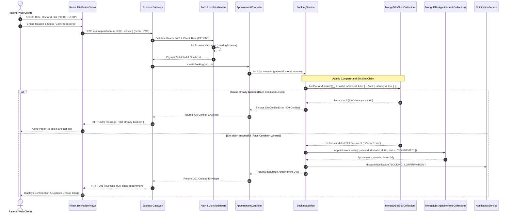
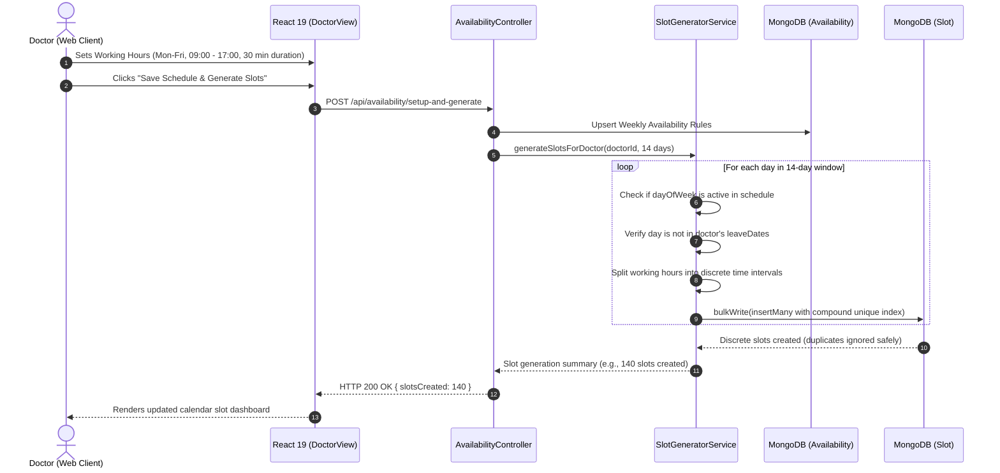
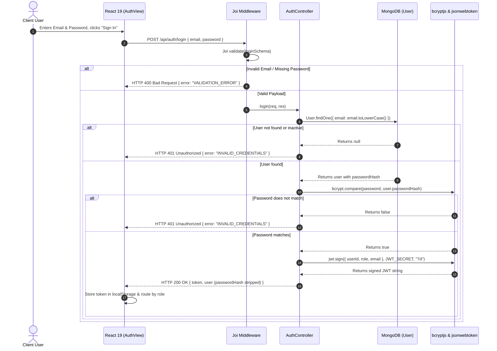

# ITM SLS BU
## School of Computer Science, Engineering & Technology, Vadodara
### B.Tech Semester-5 | AY 2026-2027, Winter-2026 | Advanced Web Development (AWD)
---

# Architectural Design Specification: MVC & Layered Architecture
### Project: CareSync — Healthcare Appointment System (HAS)
**Course:** Advanced Web Development / Project-Based Learning (PBL)  
**Deliverable:** System Architecture & Component Interaction Documentation

---

## 1. Architectural System Overview

The **CareSync Healthcare Appointment System (HAS)** is architected using a decoupled **Model-View-Controller (MVC)** and **Multi-Tier Layered Architecture**. The system decouples presentation, business orchestration, data validation, and database persistence into distinct, cohesive tiers. 

This design achieves:
- **Strict Separation of Concerns (SoC)**: Independent evolution of the client user experience and the backend business domain.
- **High Concurrency Safety**: Atomic database-level compare-and-set operations that eliminate double-booking hazards.
- **Multi-Layered Security**: End-to-end defense combining HTTP header hardening (Helmet.js), schema boundary validation (Joi), cryptographic password storage (bcrypt), and stateless Role-Based Access Control (JWT).
- **Extensibility & Maintainability**: Clean dependency inversion where controllers orchestrate services and models without tight coupling.

---

## 2. Visual Architecture Diagram


*Figure 1: Architectural blueprint of CareSync showing the View Layer (Client SPA), Controller & Middleware Layer (Express REST API Gateway), and Model & Service Layer (Mongoose ODM & MongoDB Data Store).*

---

## 3. Layer-by-Layer Architectural Decomposition

```
+─────────────────────────────────────────────────────────────────────────+
│                        1. VIEW LAYER (React 19)                         │
│  Patient Portal  │  Doctor Portal  │  Admin Center  │  Demo Switcher    │
+─────────────────────────────────────────────────────────────────────────+
                                    │
                         HTTPS / REST API Requests
                      (Bearer JWT Authentication Token)
                                    ▼
+─────────────────────────────────────────────────────────────────────────+
│          2. CROSS-CUTTING MIDDLEWARE & GATEWAY LAYER (Express)          │
│  Helmet.js (Headers) │ CORS │ Rate Limiter │ Joi Validator │ RBAC Guard │
+─────────────────────────────────────────────────────────────────────────+
                                    │
                           Clean Validated DTOs
                                    ▼
+─────────────────────────────────────────────────────────────────────────+
│                  3. CONTROLLER LAYER (C in MVC)                         │
│  AuthController │ AppointmentController │ DoctorController │ AdminCtrl  │
+─────────────────────────────────────────────────────────────────────────+
                                    │
                         Domain Commands / Queries
                                    ▼
+─────────────────────────────────────────────────────────────────────────+
│                 4. BUSINESS LOGIC & SERVICE LAYER                       │
│  Atomic Booking Engine │ Slot Generator │ Automated Notification Worker │
+─────────────────────────────────────────────────────────────────────────+
                                    │
                         Mongoose ODM Operations
                                    ▼
+─────────────────────────────────────────────────────────────────────────+
│                   5. MODEL & DATA ACCESS LAYER (M in MVC)               │
│  User │ Doctor │ Department │ Specialization │ Availability │ Slot │ ... │
│      (Compound Unique Indexes & Partial Unique Index Constraints)       │
+─────────────────────────────────────────────────────────────────────────+
                                    │
                         BSON Wire Protocol
                                    ▼
+─────────────────────────────────────────────────────────────────────────+
│                 6. PERSISTENCE LAYER (MongoDB Engine)                   │
│          Atomic Compare-and-Set Execution │ Write-Ahead Log (WAL)       │
+─────────────────────────────────────────────────────────────────────────+
```

---

### Layer 1: View Layer (Client Presentation / View in MVC)
- **Technology Stack:** React 19, Vite, Lucide Icons, Vanilla CSS Design System.
- **Architectural Responsibilities:**
  - **Persona-Driven Views:**
    - `PatientView.jsx`: Specialist directory, search/filtering by clinical department, 14-day interactive slot-picking calendar, appointment history, cancel and reschedule modals.
    - `DoctorView.jsx`: Daily/weekly patient appointment roster, clinical visit status updates (`COMPLETED`, `NO_SHOW`), working hours & slot duration setup, discrete slot generation.
    - `AdminView.jsx`: System KPI analytics, doctor credential approval queue, user activation/deactivation control, live audit log viewer.
    - `AuthView.jsx`: Role-tailored onboarding (Patient vs Doctor with medical credential fields).
  - **Client-Side State Management:** React functional hooks (`useState`, `useEffect`, `useCallback`) maintain local UI state and synchronize with the backend.
  - **API Client Service ([client/src/services/api.js](file:///d:/itm%20sem%205/25C21554/Healthcare_Appointment_System/client/src/services/api.js)):** Encapsulates all `fetch()` calls, injects the `Authorization: Bearer <token>` header, handles 401/403 redirects, and unwraps standard response envelopes.

---

### Layer 2: Cross-Cutting Middleware & Security Gateway Layer
- **Architectural Responsibilities:**
  - **HTTP Security (Helmet.js):** Applies `Content-Security-Policy`, `X-Content-Type-Options: nosniff`, and `X-Frame-Options: SAMEORIGIN`; strips `X-Powered-By`.
  - **Rate Limiting (`express-rate-limit`):** Prevents DoS and brute-force attacks by restricting traffic to 1000 requests per 15-minute window per IP.
  - **CORS Whitelisting:** Restricts cross-origin resource sharing strictly to trusted frontend origins (`http://localhost:5173`, `http://localhost:3000`).
  - **Schema Validation Middleware ([validate.js](file:///d:/itm%20sem%205/25C21554/Healthcare_Appointment_System/server/src/middlewares/validate.js)):** Executes Joi schema validation prior to controller execution, pruning unauthorized fields (`stripUnknown: true`) and returning standardized `400 Bad Request` envelopes for malformed data.
  - **Authentication & RBAC ([auth.js](file:///d:/itm%20sem%205/25C21554/Healthcare_Appointment_System/server/src/middlewares/auth.js)):**
    - `authenticate`: Cryptographically verifies JWT signatures (`HMAC-SHA256`) and checks real-time account status (`isActive: true`).
    - `authorizeRoles(...roles)`: Enforces role boundaries, rejecting unauthorized roles with `403 Forbidden`.
  - **Central Error Envelope ([errorHandler.js](file:///d:/itm%20sem%205/25C21554/Healthcare_Appointment_System/server/src/middlewares/errorHandler.js)):** Formats exceptions into uniform JSON envelopes (`{ success: false, error: { code, message } }`) and suppresses internal stack traces in production.

---

### Layer 3: Controller Layer (Application Orchestration / Controller in MVC)
- **Architectural Responsibilities:**
  - Exposes RESTful endpoints mapped to discrete resource routes ([routes/](file:///d:/itm%20sem%205/25C21554/Healthcare_Appointment_System/server/src/routes/)).
  - Decouples HTTP protocol concerns (request parameters, query strings, cookies, headers) from core domain logic.
  - Invokes domain services, handles success/failure outcomes, and formats standardized HTTP responses:
    - [authController.js](file:///d:/itm%20sem%205/25C21554/Healthcare_Appointment_System/server/src/controllers/authController.js): Registration, login, profile updates, password modification.
    - [appointmentController.js](file:///d:/itm%20sem%205/25C21554/Healthcare_Appointment_System/server/src/controllers/appointmentController.js): Booking coordination, cancellation, rescheduling, status updates.
    - [doctorController.js](file:///d:/itm%20sem%205/25C21554/Healthcare_Appointment_System/server/src/controllers/doctorController.js): Profile retrieval, specialty listings, public doctor search.
    - [slotController.js](file:///d:/itm%20sem%205/25C21554/Healthcare_Appointment_System/server/src/controllers/slotController.js): Available slot discovery, slot generation triggers.
    - [adminController.js](file:///d:/itm%20sem%205/25C21554/Healthcare_Appointment_System/server/src/controllers/adminController.js): System metrics, doctor approvals, user status toggling, audit trails.

---

### Layer 4: Business Logic & Domain Service Layer
- **Architectural Responsibilities:**
  - **Atomic Booking Engine ([bookingService.js](file:///d:/itm%20sem%205/25C21554/Healthcare_Appointment_System/server/src/services/bookingService.js)):**
    - Executes atomic compare-and-set slot claiming (`findOneAndUpdate({ _id: slotId, isBooked: false }, ...)`).
    - Prevents double-booking collisions by raising `409 Conflict`.
    - Handles safe rollbacks if appointment record persistence fails.
    - Manages atomic slot swaps during rescheduling (claims new slot, releases old slot).
    - Auto-releases slots (`isBooked: false`) upon cancellation.
  - **Slot Generator Service ([slotGeneratorService.js](file:///d:/itm%20sem%205/25C21554/Healthcare_Appointment_System/server/src/services/slotGeneratorService.js)):**
    - Reads doctor weekly availability (working days, start/end hours, slot duration).
    - Expands availability into discrete 30-minute time slots over a rolling 14-day window.
    - Respects doctor leave dates and avoids duplicate slot generation via compound unique indexing.
  - **Notification & Reminder Worker ([notificationService.js](file:///d:/itm%20sem%205/25C21554/Healthcare_Appointment_System/server/src/services/notificationService.js)):**
    - Creates in-app notification records for booking confirmations, cancellations, and reschedules.
    - Manages an automated 24-hour reminder check worker for upcoming clinical visits.

---

### Layer 5: Model & Data Access Layer (Model in MVC)
- **Architectural Responsibilities:**
  - Managed by **Mongoose ODM** models ([models/](file:///d:/itm%20sem%205/25C21554/Healthcare_Appointment_System/server/src/models/)):
    - `User`: Identity, email uniqueness, bcrypt password hash, role enum (`PATIENT`, `DOCTOR`, `ADMIN`).
    - `Doctor`: Clinical attributes, qualification, experience, fee, verification flag (`approved: Boolean`).
    - `Availability`: Weekly recurring schedule rules, working hours, slot duration, leave arrays.
    - `Slot`: Discrete calendar slot with **Compound Unique Index `(doctorId, date, startTime)`**.
    - `Appointment`: Clinical lifecycle state with **Partial Unique Index on `slotId`** where `status IN ['PENDING', 'CONFIRMED']`.
    - `Notification`: In-app alerts, unread counter index `(userId, readStatus)`.
    - `AuditLog`: Immutable forensic trail of all administrative and lifecycle actions.
  - **Data Security:** Overridden `toJSON` method guarantees `passwordHash` is never exposed over the network.

---

### Layer 6: Persistence Layer (MongoDB Engine)
- **Architectural Responsibilities:**
  - Document-level atomicity: Atomic compare-and-set operations guarantee concurrency safety without row lock contention.
  - Secondary B-Tree index enforcement: Prevents duplicate slots and overlapping active appointments at the storage engine level.
  - High read/write throughput with sub-millisecond query execution.

---

## 4. Documented Component Interactions (Flow Sequences)

### 4.1 Flow 1: High-Concurrency Atomic Appointment Booking Flow
This sequence illustrates how CareSync handles simultaneous appointment booking requests while mathematically preventing double-booking:



---

### 4.2 Flow 2: Doctor Schedule Setup & Discrete Slot Generation Flow
This interaction details how doctor availability is configured and expanded into discrete 14-day bookable slots:



---

### 4.3 Flow 3: Secure User Authentication & Role-Based Access Control Flow
This interaction illustrates how credentials are validated via bcrypt and protected by JWT authorization guards:



---

## 5. Architectural Quality Attributes & Non-Functional Requirements

| Quality Attribute | Architectural Tactic Implemented | Code Verification Location |
| :--- | :--- | :--- |
| **Concurrency Safety** | Atomic compare-and-set slot reservations combined with database-level partial unique indexing on active appointments. | [bookingService.js:L49-62](file:///d:/itm%20sem%205/25C21554/Healthcare_Appointment_System/server/src/services/bookingService.js#L49-L62), `Appointment.js:L58` |
| **Data Confidentiality** | `bcryptjs` with 10 salt rounds; Mongoose `toJSON` hook purges password hashes before transmission. | [User.js:L47-51](file:///d:/itm%20sem%205/25C21554/Healthcare_Appointment_System/server/src/models/User.js#L47-L51), [authController.js:L33](file:///d:/itm%20sem%205/25C21554/Healthcare_Appointment_System/server/src/controllers/authController.js#L33) |
| **Input Integrity** | Pre-controller Joi schema boundary validation with automatic stripping of unknown parameters (`stripUnknown: true`). | [validate.js:L10-28](file:///d:/itm%20sem%205/25C21554/Healthcare_Appointment_System/server/src/middlewares/validate.js#L10-L28), [schemas.js](file:///d:/itm%20sem%205/25C21554/Healthcare_Appointment_System/server/src/validators/schemas.js) |
| **Least Privilege (RBAC)** | Role claims embedded in JWTs; Express middleware guards enforce route-level access rules (Patient, Doctor, Admin). | [auth.js:L44-56](file:///d:/itm%20sem%205/25C21554/Healthcare_Appointment_System/server/src/middlewares/auth.js#L44-L56), [appointmentRoutes.js](file:///d:/itm%20sem%205/25C21554/Healthcare_Appointment_System/server/src/routes/appointmentRoutes.js) |
| **Resilience & Fault Isolation** | Centralized error envelope intercepts exceptions; internal stack traces suppressed in production mode. | [errorHandler.js:L3-49](file:///d:/itm%20sem%205/25C21554/Healthcare_Appointment_System/server/src/middlewares/errorHandler.js#L3-L49) |
| **Response Predictability** | Standard JSON envelope pattern across all 20+ API endpoints (`{ success, data, message }` / `{ success, error }`). | [responseEnvelope.js](file:///d:/itm%20sem%205/25C21554/Healthcare_Appointment_System/server/src/utils/responseEnvelope.js) |

---

## 6. Conclusion

The modeled MVC and Layered Architecture for **CareSync (Healthcare Appointment System)** establishes a resilient, production-ready foundation. By separating client presentation, middleware guards, controller coordination, business logic services, and database persistence, the architecture ensures high concurrency safety, verifiable role-based access control, and seamless developer maintainability.
